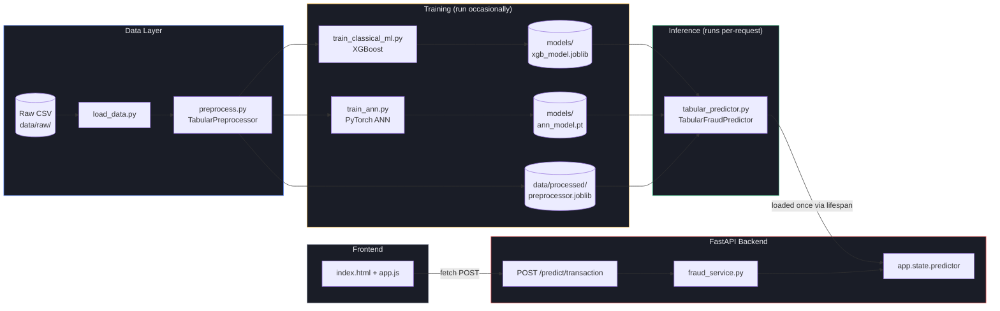
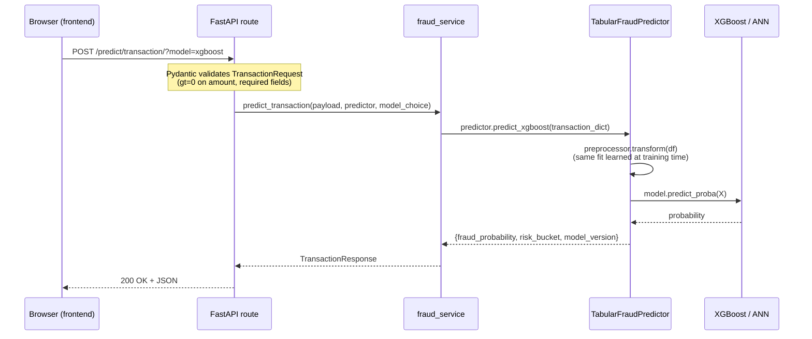
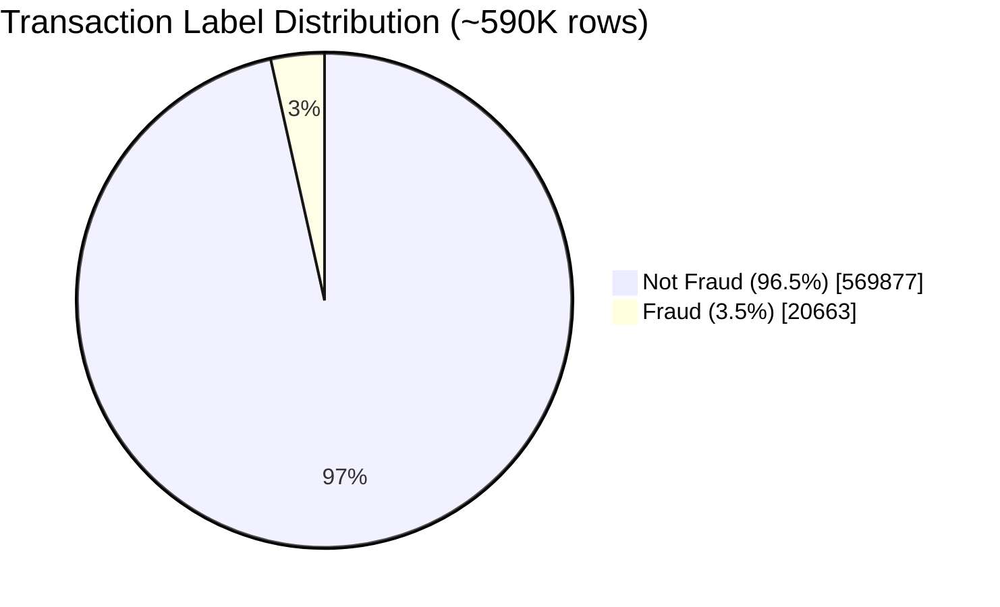
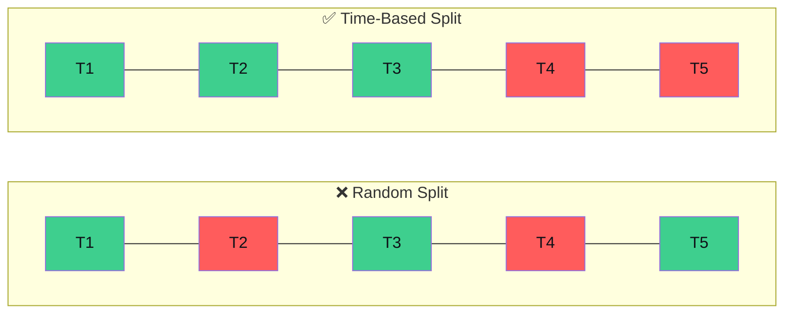
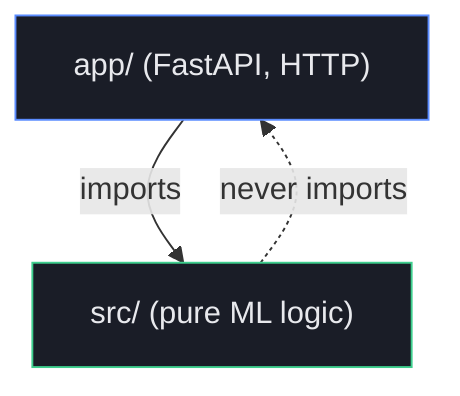
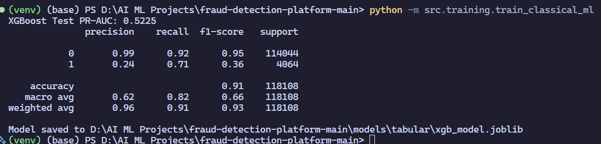
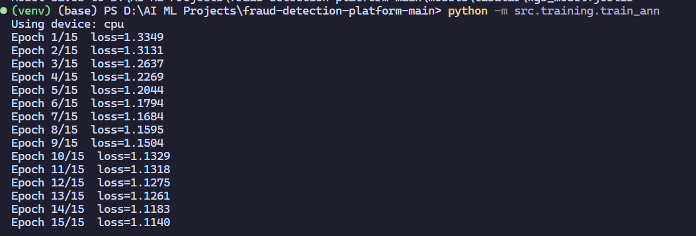
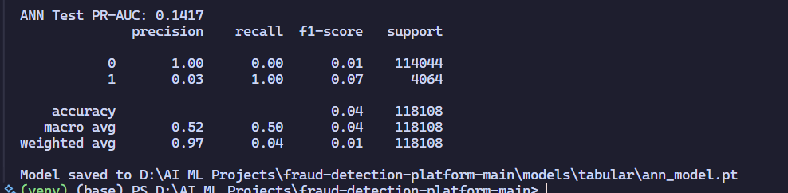
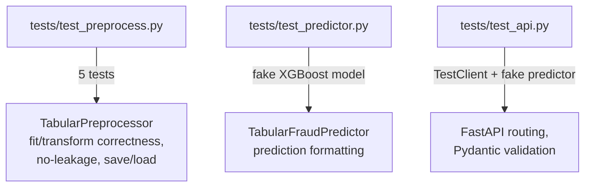

# Fraud Detection Platform

**A production-structured fraud detection system combining classical ML and deep learning, served via FastAPI with a live demo frontend.**

[](https://www.python.org/)
[](https://fastapi.tiangolo.com/)
[](https://pytorch.org/)
[](https://xgboost.ai/)
[](#testing)
[](#license)

---

## Table of Contents

- [Problem](#problem)
- [Architecture](#architecture)
- [Data](#data)
- [Design Decisions](#design-decisions)
- [Project Structure](#project-structure)
- [Setup & Running](#setup--running)
- [API Reference](#api-reference)
- [Testing](#testing)
- [What I'd Improve](#what-id-improve)
- [License](#license)

---

## Problem

Fraud detection in production is never one model reading one signal — real systems reason over multiple, independent lines of evidence before flagging a transaction. This project builds the first, fully-working piece of such a system: a **transaction risk scoring API** that evaluates incoming transactions using **two independently-trained models** — a gradient-boosted tree ensemble (XGBoost) and a feedforward neural network built from scratch in PyTorch — trained on identical, honestly-split, real-world data.

The goal was not to chase a leaderboard score. It was to build something that behaves the way a real fraud system has to: trained without leaking the future into the past, evaluated with metrics that mean something on a 96.5%-imbalanced dataset, and served through an API architecture that separates ML logic from HTTP concerns cleanly enough to swap, test, or extend either side independently.

**Dataset:** [IEEE-CIS Fraud Detection](https://www.kaggle.com/c/ieee-fraud-detection) (Kaggle) — ~590,000 real, anonymized transactions, ~3.5% labeled fraud.

---

## Architecture

### System overview



### Request lifecycle



**Key property:** the model and preprocessor are loaded **once**, at server startup (via FastAPI's `lifespan`), and reused across every request — not reloaded per-call. See [`app/main.py`](app/main.py).

---

## Data

| | |
|---|---|
| Source | IEEE-CIS Fraud Detection (Kaggle) |
| Rows | ~590,540 |
| Columns (raw) | ~394 |
| Fraud rate | ~3.5% |
| Columns dropped (>90% missing) | see `TabularPreprocessor.cols_to_drop_` after fitting |
| Split method | **Time-based**, not random (see [Design Decisions](#design-decisions)) |

### Class imbalance, visualized



A classifier that always predicts "not fraud" scores **96.5% accuracy** while catching zero fraud — this is the reason accuracy is never used as the primary metric anywhere in this project 

---

## Design Decisions

Each decision below follows the same shape: **what was chosen → why → what it cost.**

### 1. Time-based train/test split, not random

The dataset carries a real time column, `TransactionDT`. A random split would let the model train on transactions that occurred chronologically *after* some of its own test transactions — leaking information about the future into training in a way that cannot happen in real deployment, where a model only ever sees the past.



**Cost:** lost the ability to force identical train/test fraud rates via stratification — chronological order decides the split, not balance.

### 2. One shared `TabularPreprocessor` class for both models

XGBoost and the ANN train on **identically** cleaned, encoded, and scaled data — fit once on training data only, applied via `.transform()` to everything downstream (test data and live predictions alike). This makes the PR-AUC comparison in [Results](#results) an honest, apples-to-apples comparison rather than two separately-prepared pipelines that happen to be compared.

### 3. `fit`/`transform` discipline enforced structurally, not just by convention

Every learned statistic (column drop list, medians, one-hot columns, scaler mean/std) is computed **only** inside `fit()`, from whatever data it's given, and stored on `self`. `transform()` never recomputes anything — it only applies what was already learned. This is tested explicitly (`tests/test_preprocess.py::test_transform_does_not_use_test_data_statistics`), not just assumed.

### 4. PR-AUC over accuracy as the primary metric

Covered in [Results](#results) — worth repeating here because it drove every evaluation decision in the project, not just the final number reported.

### 5. Class-weighted loss over SMOTE for the ANN

Tried both. `BCEWithLogitsLoss(pos_weight=...)` performed comparably to SMOTE-based oversampling, without the risk SMOTE carries of generating unrealistic synthetic fraud examples by interpolating between real ones in feature space.

### 6. `src/` never imports from `app/`



All ML logic is framework-agnostic — every `src/` module is callable, testable, and reusable from a plain script, a different web framework, or a notebook, with zero dependency on FastAPI ever being installed.

### 7. PyTorch model saved as a state dict + architecture metadata, not a single object

Unlike `joblib.dump(xgb_model, ...)`, which serializes the complete fitted object, PyTorch's `state_dict()` only captures learned weights — not the architecture that produced them. `train_ann.py` saves `{model_state_dict, input_dim, hidden_sizes, dropout}` together; `tabular_predictor.py` rebuilds an empty `FraudANN` with those exact dimensions before loading the weights into it. Saving only the weights without the shape metadata would make the checkpoint unusable.

---

## Project Structure

```
fraud-detection-platform/
├── README.md
├── requirements.txt
├── .gitignore
│
├── data/
│   ├── raw/                     # original Kaggle CSV — never modified by code
│   └── processed/                # generated artifacts (preprocessor.joblib)
│
├── models/
│   └── tabular/                  # trained model files (xgb_model.joblib, ann_model.pt)
│
├── src/                           # pure ML logic — zero FastAPI imports
│   ├── config.py                   # single source of truth for paths & settings
│   ├── data/
│   │   ├── load_data.py              # raw CSV → DataFrame
│   │   └── preprocess.py              # TabularPreprocessor (fit/transform), time_based_split
│   ├── training/
│   │   ├── train_classical_ml.py       # trains & saves XGBoost
│   │   ├── ann_model.py                 # FraudANN architecture (nn.Module)
│   │   └── train_ann.py                  # training loop, saves ANN checkpoint
│   └── inference/
│       └── tabular_predictor.py           # loads both models once, serves predictions
│
├── app/                             # HTTP layer — thin, delegates to src/
│   ├── main.py                        # FastAPI app, lifespan model loading
│   ├── schemas/transaction.py          # Pydantic request/response models
│   ├── routes/transaction.py            # POST /predict/transaction/
│   └── services/fraud_service.py         # bridges routes → src/inference
│
├── frontend/                        # plain HTML/CSS/JS — talks to the API over fetch()
│   ├── index.html
│   ├── css/styles.css
│   └── js/
│       ├── api.js                      # only file that calls fetch()
│       └── app.js                       # only file that touches the DOM
│
└── tests/                           # mirrors src/ and app/ structure
    ├── test_preprocess.py
    ├── test_predictor.py
    └── test_api.py
```

**The organizing principle:** files are grouped by **role** (data / training / inference / serving / UI), not by feature. Every file does exactly one job; the name tells you which.

---

## Setup & Running

```bash
# 1. Clone and enter the project
git clone <your-repo-url>
cd fraud-detection-platform

# 2. Create and activate a virtual environment
python -m venv venv
venv\Scripts\activate          # Windows
source venv/bin/activate        # macOS/Linux

# 3. Install dependencies
pip install -r requirements.txt
```

Download `train_transaction.csv` from the [IEEE-CIS Fraud Detection competition](https://www.kaggle.com/c/ieee-fraud-detection/data) and place it at:

```
data/raw/train_transaction.csv
```

```bash
# 4. Train both models (saves to models/tabular/ and data/processed/)
python -m src.training.train_classical_ml
python -m src.training.train_ann

# 5. Run the API
uvicorn app.main:app --reload
```

Open `http://127.0.0.1:8000/docs` for interactive API docs, or open `frontend/index.html` directly in a browser for the live demo (backend must be running).

```bash
# 6. Run the test suite
pytest tests/ -v
```

---

## Results

### 1. **XG-Boost Results**


### 2. **ANN Results**




---

## API Reference

### `POST /predict/transaction/`

**Query parameters**

| Param | Type | Default | Description |
|---|---|---|---|
| `model` | string | `"xgboost"` | `"xgboost"` or `"ann"` |

**Request body**

```json
{
  "TransactionAmt": 125.50,
  "ProductCD": "W",
  "card4": "visa",
  "card6": "credit",
  "P_emaildomain": "gmail.com"
}
```

**Response `200 OK`**

```json
{
  "fraud_probability": 0.0234,
  "risk_bucket": "low",
  "model_version": "xgboost_v1"
}
```

**Response `422 Unprocessable Entity`** — returned automatically by Pydantic validation (e.g., `TransactionAmt <= 0`) before the route body ever executes.

### `GET /health`

Returns `{"status": "ok"}` — liveness check.

---

## Testing



Tests use **fake/stand-in models** (not the real trained XGBoost/ANN) so the suite runs in milliseconds and passes on a fresh clone, before any training has happened. Real model correctness is validated by the PR-AUC reported in [Results](#results), not by the test suite — the test suite validates *pipeline* correctness (no leakage, correct shapes, correct HTTP behavior), which is a different and equally important kind of correctness.

```bash
pytest tests/ -v
```

---

